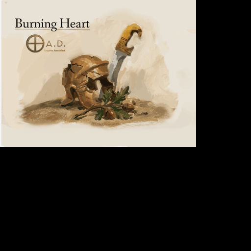

# Burning Heart — Scenario 1: The Blood of Lusitania

<p align="center">
  
</p>

A narrative scenario for [0 A.D.](https://play0ad.com) set in Ancient Iberia around **147 BC**, during the resistance led by **Viriathus** against Rome. It is the first scenario of **Burning Heart**, a narrative campaign project for 0 A.D.

The scenario focuses on atmosphere, historical immersion and exploration: gathering resources, preparing defences against the Roman offensive, and facing betrayal from within. It features a continuous, evolving soundscape built from home-made instruments (straw-flute aulos, truck-horn texture, war drums, drones), grounded in ancient sources such as Appian.

It is designed as a standalone piece, but also as a building block for a future Iberian campaign in 0 A.D.

> **Project thread:** [Devlog: Burning Heart, a narrative campaign for 0 A.D.](https://wildfiregames.com/forum/topic/170017-devlog-burning-heart-a-narrative-campaign-for-0-ad/#comment-762999) (Wildfire Games forum)

---

## Table of contents

1. [Quick start](#quick-start)
2. [How to play](#how-to-play)
3. [Story and gameplay](#story-and-gameplay)
4. [The map at a glance](#the-map-at-a-glance)
5. [Soundtrack](#soundtrack)
6. [Project structure](#project-structure)
7. [For modders: working on this project](#for-modders-working-on-this-project)
8. [Documentation](#documentation)
9. [Known issues and to-do](#known-issues-and-to-do)
10. [Credits](#credits)
11. [Licences](#licences)
12. [Links](#links)

---

## Quick start

1. **Install 0 A.D.** (free): <https://play0ad.com>
2. **Download this project:** green **Code** button on GitHub, then **Download ZIP**, and unzip it. (Or `git clone https://github.com/lilypoppybooks/burning-heart-scenario-1`.)
3. **Copy the `viratio` folder** (the one containing `mod.json`) into your 0 A.D. `mods` folder:

   | System  | Mods folder                                    |
   |---------|------------------------------------------------|
   | Windows | `Documents\My Games\0ad\mods`                  |
   | Linux   | `~/.local/share/0ad/mods`                      |
   | macOS   | `~/Library/Application Support/0ad/mods`       |

4. **Enable the mod:** main menu, *Tools & Options*, *Mod Selection*, select **Viratio Campaign**, *Enable*, then *Save and Restart*.
5. **Play:** *Single Player*, *Scenario*, **Viratio**.

> The scenario does not show up? Make sure `mod.json` sits directly in `mods/viratio/`, not in `mods/viratio/viratio/`.

## How to play

You control **Viriathus** and a small band of Lusitanian fighters.

| Phase | What you do |
|-------|-------------|
| **1. Prepare** | Explore the land and gather resources. The City Phase is disabled for everyone. |
| **2. Capture the village** | Walk one of your units close to the abandoned Iberian village (within 60 m of the marker). Its 13 buildings become yours. |
| **3. Survive** | Five seconds later the Roman camp army marches on the village. Hold it. |
| **4. Turning point** | Kill the Roman general **Marcellus**. The Romans retreat, and the two Iberian chiefs who sided with Rome turn on you. |
| **5. Betrayal** | Defeat both **Thitti** and **Belli** to win. |

**You lose** if Viriathus dies or if the village centre is destroyed.
**You win** when both Thitti and Belli are defeated.

## Story and gameplay

Set during the Lusitanian resistance against Rome, the scenario is about tension and atmosphere rather than a fast-paced battle: patient preparation, a long waiting game under a changing soundscape, then a sudden Roman offensive, and finally a betrayal by supposed allies.

### Players

| # | Name | Civ | Controlled by | Notes |
|---|------|-----|---------------|-------|
| 0 | Gaia | n/a | nobody | Nature and the abandoned village |
| 1 | Virato | Iberians | **you** | Hero Viriathus, ~70 units, population limit 200 |
| 2 | Legion | Romans | scripted | Large army (~380 units), no AI, moved by trigger script |
| 3 | Thitti | Iberians | Petra AI | Population limit 150 |
| 4 | Belli | Iberians | Petra AI | Population limit 150 |

### Diplomacy

At the start, Thitti and Belli are **neutral** to you and **allied** to Rome and to each other. When the Roman general dies, they become your **enemies**.

## The map at a glance

<p align="center">
  
</p>

Circular map, 480 x 480 tiles (1920 x 1920 units). Viriathus starts on the west side. The abandoned village (trigger point A) is in the south-east. The Roman camp is in the north, and a Roman army guards the pass in the west.

<p align="center">
  
</p>

## Soundtrack

*Echoes of Iberias*, original soundtrack by **Felix Lahaie (LilyPoppy)**, licensed CC BY-SA 3.0.

| # | Track | Length | Played during |
|---|-------|--------|---------------|
| 1 | Echoes of Iberias | 7:00 | peace |
| 2 | Silence of Iberia (credited "Silence of the Sun") | 0:20 | peace |
| 3 | The Numantine Rises | 3:00 | battle |
| 4 | Spirit of the Guerrilla | 1:00 | peace |

*The Numantine Rises* uses a sample of a Celtiberian trumpet from the [Museo Arqueológico Nacional](https://www.man.es/man/dam/jcr:67f6d69f-1de7-4323-be39-82f4b40a8a33/4-trompeta-celtiberica--marichalar-y-saenz-de-tejada.mp3) (Villar del Río, Soria; Marichalar y Sáez de Tejada Collection). Melody performed by Rubén Perelló Blanquer and María José Ucar, recorded and edited by Dr Raquel Jiménez Pasalodos, used with permission under CC BY-SA 3.0, and remixed by Felix Lahaie.

## Project structure

```
burning-heart-scenario-1/
├── README.md
├── GPL 2.0                        Licence text (code and data)
├── CC BY-SA 3.0                   Licence text (art and audio)
├── docs/                          Illustrated beginner guide and images
└── viratio/                       THE MOD: copy this folder into 0 A.D.
    ├── mod.json                   Mod identity (name, version, depends on 0ad)
    ├── CREDITS.txt
    ├── maps/scenarios/
    │   ├── viratio.pmp            Terrain (edited with Atlas only)
    │   ├── viratio.xml            Objects, players, settings (~1,440 entities)
    │   └── viratio.js             Game rules: triggers, win/lose, Roman attack
    ├── simulation/
    │   ├── components/            Health.js, Trigger.js
    │   └── data/civs/iber.json    Iberian civ definition and music list
    ├── gui/session/session.js
    ├── audio/music/               4 .ogg tracks + CREDITS.txt
    └── art/textures/ui/session/icons/mappreview/viratio.png
```

## For modders: working on this project

The scenario was built with **Atlas**, the map editor included in 0 A.D. (main menu, *Tools & Options*, *Scenario Editor*).

**The rules** live in `viratio/maps/scenarios/viratio.js`. Four triggers drive everything:

| Event | Function | Effect |
|-------|----------|--------|
| `OnInitGame` | `DisableTechnologies` | Bans `phase_city` |
| `OnEntityDeath` | `CheckKill` | Viriathus or village centre dies = defeat. Roman general dies = Romans retreat, Iberian AIs turn hostile |
| `OnRange` | `CommandCenterCapture` | A unit near trigger point A gives you the village and starts the Roman attack |
| `OnPlayerDefeated` | `OnPlayerDefeatedAction` | Both Thitti (3) and Belli (4) defeated = victory |

**Important:** the script refers to entities by their **ID** (for example Viriathus is `611`, the Roman general `1183`, the village centre `1127`). Adding or deleting entities in Atlas can change these numbers. After any edit, open `viratio.xml`, search for the template name (such as `hero_viriato`), and check that the `uid` still matches the number in `viratio.js`.

Typical workflow: design in Atlas, save (`.xml` + `.pmp`), check entity IDs, edit `viratio.js`, test in the game, repeat.

Helpful community tools (see `viratio/CREDITS.txt`):
- [Post-Atlas](https://wildfiregames.com/forum/topic/169808-map-making-support-and-conversion-tool-post-atlas/page/3/#comment-763845): map-making support and conversion tool
- [Mercator](https://wildfiregames.com/forum/topic/169940-new-atlas-helper-tool-mercator): Atlas helper tool

## Documentation

**Illustrated beginner guide (English, 18 pages):** [`docs/Burning-Heart-Scenario-1-Visual-Guide.odt`](docs/Burning-Heart-Scenario-1-Visual-Guide.odt)

It explains, with diagrams and no prior Atlas knowledge needed: the folder layout, installation, the map, the trigger script function by function, an Atlas crash course, and an 11-step roadmap to build your own scenario.

## Known issues and to-do

Observations from reading the files, not all confirmed bugs:

- `CommandCenterCapture` schedules a `TimerStart` function that is not defined in `viratio.js`.
- The AI player is named *Thitti*, but the victory message says *Thetti*.
- The map description in Atlas is still the placeholder text.
- `Health.js`, `Trigger.js` and `session.js` look like copies of 0 A.D. engine files; they may need updating when the game updates.
- The second music track is credited as "Silence of the Sun" but the file is `Silence_of_Iberia.ogg`.
- Entity IDs are hard-coded in the script (see above).

## Credits

- **Felix Lahaie (LilyPoppy):** scenario design, music, project lead
- **Thalatta:** historical review and Appian documentation
- **Perzival12:** programming and trigger implementation
- **Nicolaus_von_Kues:** human resources and idea sharing
- **Grautvornix:** Post-Atlas and Mercator tools, which greatly facilitated development in Atlas
- **Vantha:** Iberian biome, shared before its official release
- **Stan:** project direction, recommendations and licensing guidance
- **Dr. Raquel Jiménez Pasalodos:** research on Iberian music, recommendations and further research directions
- The **0 A.D. community** for its support and inspiration
- And the author's wife and rabbits, for their patience and support

## Licences

| What | Licence |
|------|---------|
| Code and data | [GPL 2.0 or later](https://www.gnu.org/licenses/old-licenses/gpl-2.0.html), see [`GPL 2.0`](GPL%202.0) |
| Art and audio | [CC BY-SA 3.0](https://creativecommons.org/licenses/by-sa/3.0/), see [`CC BY-SA 3.0`](CC%20BY-SA%203.0) |

You are free to share and adapt the music, even commercially, as long as you credit the artist and share under the same licence.

## Links

- Game: <https://play0ad.com>
- Project devlog: <https://wildfiregames.com/forum/topic/170017-devlog-burning-heart-a-narrative-campaign-for-0-ad/#comment-762999>
- Post-Atlas: <https://wildfiregames.com/forum/topic/169808-map-making-support-and-conversion-tool-post-atlas/page/3/#comment-763845>
- Mercator: <https://wildfiregames.com/forum/topic/169940-new-atlas-helper-tool-mercator>
- Repository: <https://github.com/lilypoppybooks/burning-heart-scenario-1>
- CC BY-SA 3.0: <https://creativecommons.org/licenses/by-sa/3.0/>
- GPL 2.0: <https://www.gnu.org/licenses/old-licenses/gpl-2.0.html>
